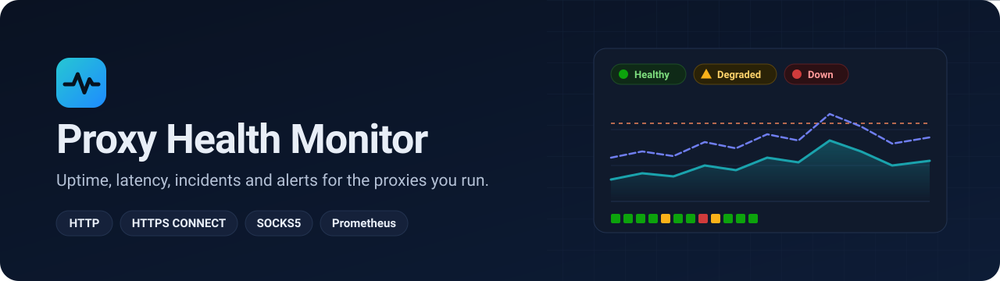
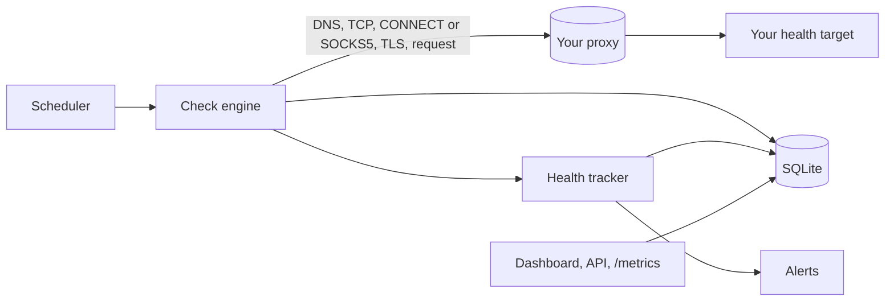

<p align="center">
  <a href="https://fusionproxy.net/?utm_source=github&utm_medium=referral&utm_campaign=proxy-health-monitor">
    <picture>
      <source media="(prefers-color-scheme: dark)" srcset="https://raw.githubusercontent.com/FusionProxies/.github/main/assets/logo-on-dark.png">
      
    </picture>
  </a>
</p>

<p align="center">
  
</p>

# Proxy Health Monitor

*Open-source HTTP, HTTPS and SOCKS5 proxy monitoring with uptime tracking, latency metrics and alerts.*

[](https://pkg.go.dev/github.com/FusionProxies/proxy-health-monitor)
[](LICENSE)

`proxy-monitor` checks the proxies you run, or are authorized to monitor, on a schedule. Each check goes through the proxy to a health endpoint you control. It times every phase, classifies every failure, keeps the history in SQLite, opens and closes incidents, and sends alerts. A local dashboard, a REST API and Prometheus metrics come with it. It is one binary with no external services, and it works with any provider.

## Contents

- [Features](#features)
- [Quickstart](#quickstart)
- [Configuration](#configuration)
- [Command line](#command-line)
- [Dashboard](#dashboard)
- [How it works](#how-it-works)
- [Docker](#docker)
- [Alerts](#alerts)
- [API and Prometheus](#api-and-prometheus)
- [Using it with Fusion Proxy](#using-it-with-fusion-proxy)
- [Security](#security)
- [Troubleshooting](#troubleshooting)
- [Development](#development)

## Features

- **HTTP, HTTPS and SOCKS5.** HTTP forward proxies, CONNECT tunnels (also over TLS to the proxy), and SOCKS5 TCP CONNECT with username/password, with local (`socks5://`) or remote (`socks5h://`) DNS.
- **Every phase timed.** DNS, TCP connect, proxy handshake, TLS with the target, time to first byte, and total, plus the bytes each check used.
- **Failures you can act on.** 12 stable failure classes, such as `auth_failed` (407, or SOCKS5 status 0x01), `upstream_unreachable` (SOCKS5 replies 0x03 to 0x06, or 502/503/504 to CONNECT), `protocol_error` (an HTTP proxy checked as SOCKS5), `timeout` with the phase it happened in, and `tls_error`.
- **History and statistics.** Last success and failure, rolling availability, average, median and p95 latency, uptime for 1h, 24h, 7d and 30d, and consecutive failures. Retention is configurable.
- **Incidents.** Each down, slow or low-availability period is recorded with start, end and duration, and survives restarts.
- **Alerts without floods.** Console, webhook (HMAC-signed), email, Telegram and Discord. Deduplication, per-proxy cooldown and a global rate limit with a summary message.
- **Dashboard.** Overview, per-proxy detail with latency and availability charts, incidents with the alert history, and settings. Dark, fast, and no external requests.
- **API and metrics.** A read-only REST API and Prometheus `/metrics`, with ready-made alert rules.
- **Safe by default.** Dashboard on `127.0.0.1`, a token required for any other address, Host-header checks against DNS rebinding, and credentials masked in every output.
- **Conservative.** A 10 second interval floor, global and per-target concurrency limits, spacing between checks to the same target, timeouts on every phase, and graceful shutdown.
- **Portable.** One static binary for Linux, macOS and Windows. The SQLite driver is pure Go, so no cgo. A distroless Docker image.

## Quickstart

**1. Install.** Download a binary from [Releases](https://github.com/FusionProxies/proxy-health-monitor/releases) (check it against `checksums.txt`), or build with Go 1.24 or newer:

```bash
go install github.com/FusionProxies/proxy-health-monitor/cmd/proxy-monitor@latest
```

**2. Try it without any proxy.** The demo starts seven local test proxies with different faults and serves the real dashboard on demo data:

```bash
proxy-monitor demo        # then open http://127.0.0.1:8090
```

**3. Monitor your own proxies.**

```bash
proxy-monitor init                    # writes proxy-monitor.yaml with comments
# edit it: your proxies, and a target you control
proxy-monitor validate                # checks the file, contacts nothing
proxy-monitor check                   # one check per proxy, exit code 1 if any fails
proxy-monitor start                   # scheduler, alerts, dashboard on http://127.0.0.1:8090
```

You need a target: an endpoint you control that the checks request through each proxy. `proxy-monitor target` runs a minimal one that answers `ok` and logs nothing:

```bash
# on a server you control
proxy-monitor target -listen 0.0.0.0:8080      # serves http://<server>:8080/healthz
```

## Configuration

```yaml
storage:
  path: proxy-monitor.db
  retention: 30d

server:
  listen: 127.0.0.1:8090
  # auth_token: ${PROXY_MONITOR_TOKEN}   # required if listen is not on localhost

monitor:
  interval: 60s          # never below 10s for remote proxies
  timeout: 10s
  concurrency: 4

thresholds:
  failure_threshold: 3   # failures in a row before "down"
  recovery_threshold: 2
  latency: 3s            # median of the last 5 successful checks
  availability: 95       # percent of checks in availability_window
  availability_window: 1h

targets:
  - name: own-health
    url: https://health.example.com/healthz
    expect_body: ok
    max_concurrent: 2    # per-target limits, across all proxies
    min_spacing: 500ms

proxies:
  - name: office-http
    url: http://proxy.internal.example:3128
    labels: {site: office}

  - name: vendor-socks5
    url: socks5h://proxy.vendor.example:1080
    username: ${VENDOR_PROXY_USER}     # read from the environment
    password: ${VENDOR_PROXY_PASS}
    interval: 2m

alerts:
  cooldown: 10m
  webhooks:
    - url: https://hooks.example.com/proxy-monitor
      secret: ${WEBHOOK_SECRET}
```

Every key, default and limit: [docs/configuration.md](docs/configuration.md). More examples: [examples/](examples).

## Command line

| Command | What it does |
|---|---|
| `proxy-monitor init` | Write an annotated sample configuration (`-config`, `-force`) |
| `proxy-monitor validate` | Check a configuration without contacting anything |
| `proxy-monitor check` | Check each proxy once and exit, with `-proxy a,b` to pick proxies and `-json` for scripts. Exit code `1` if any check fails |
| `proxy-monitor start` | Run the monitor (`-log-level`, `-log-format text\|json`). Ctrl+C or SIGTERM stops it gracefully |
| `proxy-monitor status` | The current state of every proxy, from the database. Exit code `1` if any proxy is down |
| `proxy-monitor report` | Uptime and latency for a period: `-since 24h\|7d\|30d`, `-format table\|json\|csv\|markdown`, `-proxy` |
| `proxy-monitor target` | Run a minimal health endpoint (`-listen`, `-path`, `-tls-cert`, `-tls-key`) |
| `proxy-monitor demo` | The dashboard on local test proxies, with demo data clearly marked |
| `proxy-monitor healthcheck` | Exit `0` if a running monitor answers `/api/health` (for containers) |

Every command takes `-config` (default `proxy-monitor.yaml`, or `$PROXY_MONITOR_CONFIG`). The output below is real, from local test proxies:

```
$ proxy-monitor check
PROXY            PROTOCOL             RESULT  TOTAL  CONNECT  TTFB  DETAIL
office-http      HTTP forward         ok      25ms   0ms      25ms  HTTP 200
eu-connect       HTTP CONNECT         ok      166ms  165ms    0ms   HTTP 200
us-socks5        SOCKS5 (remote DNS)  ok      244ms  244ms    -     HTTP 200
old-credentials  SOCKS5 (remote DNS)  FAIL    -      -        -     auth_failed: the proxy rejected the username or password (status 0x01)

3 of 4 proxies passed
```

```
$ proxy-monitor status
PROXY            STATE     LAST CHECK  24H UPTIME  P50    P95    FAILS  LAST ERROR
office-http      HEALTHY   2s ago      100.00%     34ms   40ms   0
eu-connect       HEALTHY   2s ago      100.00%     132ms  166ms  0
us-socks5        DEGRADED  1s ago      77.78%      219ms  246ms  0      SOCKS5 reply 0x04: target host unreachable from the proxy
old-credentials  DOWN      0s ago      0.00%       -      -      27     the proxy rejected the username or password (status 0x01)

Open incidents:
  us-socks5: #2 availability since 2026-11-17 12:19
  old-credentials: #1 down since 2026-11-17 12:19
```

```
$ proxy-monitor report -since 1h -format markdown
| Proxy | Protocol | Checks | Uptime | p50 | p95 | Incidents | Downtime |
|---|---|---:|---:|---:|---:|---:|---:|
| eu-connect | HTTP CONNECT | 27 | 100.00% | 132ms | 166ms | 0 | 0s |
| office-http | HTTP forward | 27 | 100.00% | 34ms | 40ms | 0 | 0s |
| old-credentials | SOCKS5 (remote DNS) | 27 | 0.00% | - | - | 1 | 54s |
| us-socks5 | SOCKS5 (remote DNS) | 27 | 77.78% | 219ms | 246ms | 2 | 9s |
```

## Dashboard

See it without any proxy: `proxy-monitor demo` serves the real dashboard on local test proxies, with a "DEMO DATA" banner on every page.

- **Overview:** proxies configured, healthy, degraded and down, a 24-hour availability strip per proxy, median and p95 latency, the last error, and recent incidents. Filter by state, name, label or protocol.
- **Proxy detail:** availability for 1h, 24h, 7d and 30d; latency (p50 and p95 against the threshold) and availability charts with hover details; where the time goes (DNS, connect, handshake, TLS, TTFB); recent errors; incidents; and a table of the latest checks.
- **Incidents:** failures, recoveries and durations, plus every alert that was sent or suppressed, with the reason.
- **Settings:** monitoring frequency, thresholds, retention, alert channels and the authorized target endpoints. This page is read-only: the configuration file is the source of truth.

The dashboard is plain HTML, CSS and JavaScript embedded in the binary. It loads nothing from other sites, and its Content-Security-Policy forbids it.

## How it works



1. The scheduler runs each proxy on its own interval with jitter, within the global concurrency limit and each target's limits.
2. The check engine speaks the proxy protocol itself (HTTP forward, CONNECT, or SOCKS5 per RFC 1928 and 1929), so it can time every phase and tell a 407 from a SOCKS5 reply code from silence on the port.
3. The health tracker turns results into states (healthy, degraded, down) and incidents (down, slow, low availability).
4. The alert manager deduplicates, applies cooldowns and the rate limit, and delivers.

Definitions of uptime, percentiles and states: [docs/metrics.md](docs/metrics.md). Design notes: [docs/architecture.md](docs/architecture.md).

## Docker

```bash
mkdir -p config && cp examples/docker/proxy-monitor.yaml config/proxy-monitor.yaml   # edit it
printf 'PROXY_MONITOR_TOKEN=%s\n' "$(openssl rand -hex 24)" > .env                   # plus proxy credentials
docker compose up -d
```

The image is distroless and runs as non-root, with a built-in health check. Compose publishes the dashboard on the host's `127.0.0.1:8090` only. systemd, reverse proxy, Prometheus and backups: [docs/deployment.md](docs/deployment.md).

## Alerts

| Event | When |
|---|---|
| `down` | `failure_threshold` consecutive failures |
| `recovered` | `recovery_threshold` consecutive successes after being down |
| `latency` / `latency_resolved` | the median of recent successful checks crosses the `latency` threshold |
| `availability` / `availability_resolved` | the success rate in the window crosses the `availability` threshold |
| `still_down` | optional reminder every `repeat_interval` |

```yaml
alerts:
  cooldown: 10m            # one alert pair per proxy and kind per cooldown
  max_per_minute: 20       # the rest is summarized in one message
  webhooks:
    - url: https://hooks.example.com/proxy-monitor
      secret: ${WEBHOOK_SECRET}            # X-Proxy-Monitor-Signature: sha256=HMAC
      events: [down, recovered]
  email:
    host: smtp.example.com
    username: ${SMTP_USER}
    password: ${SMTP_PASS}
    from: proxy-monitor@example.com
    to: [ops@example.com]
  telegram:
    bot_token: ${TELEGRAM_BOT_TOKEN}
    chat_id: ${TELEGRAM_CHAT_ID}
  discord:
    - webhook_url: ${DISCORD_WEBHOOK_URL}
```

Payload format, signature verification and channel notes: [docs/alerts.md](docs/alerts.md).

## API and Prometheus

| Endpoint | |
|---|---|
| `GET /api/health` | Liveness, public |
| `GET /api/proxies` | All proxies with state and 24h statistics |
| `GET /api/proxies/{name}` | One proxy: 1h/24h/7d/30d statistics, phases, errors, incidents |
| `GET /api/proxies/{name}/series?window=24h` | Bucketed latency and availability for charts |
| `GET /api/proxies/{name}/checks` | Raw checks |
| `GET /api/metrics` | Summary counts |
| `GET /api/incidents`, `GET /api/alerts` | Incidents and the alert history |
| `GET /api/settings` | Effective configuration, without secrets |
| `GET /metrics` | Prometheus text format |
| `POST /api/proxies/{name}/check` | Check now (needs the token, a CSRF header, and respects the interval floor) |

```bash
curl -H "Authorization: Bearer $PROXY_MONITOR_TOKEN" http://127.0.0.1:8090/api/proxies
```

Metrics include `proxy_monitor_up`, `proxy_monitor_state`, `proxy_monitor_checks_total`, `proxy_monitor_check_errors_total{class}`, `proxy_monitor_check_duration_seconds` (histogram), `proxy_monitor_phase_seconds{phase}` and `proxy_monitor_check_bytes_total`. Full reference: [docs/api.md](docs/api.md) and [docs/metrics.md](docs/metrics.md). Scrape config and alert rules: [examples/prometheus](examples/prometheus).

## Using it with Fusion Proxy

This project is maintained by [Fusion Proxy](https://fusionproxy.net/?utm_source=github&utm_medium=referral&utm_campaign=proxy-health-monitor). It works the same with any provider and needs no Fusion Proxy account. If you do use Fusion Proxy residential proxies, [examples/fusionproxy.yaml](examples/fusionproxy.yaml) has a configuration built from the [documented endpoints](https://github.com/FusionProxies/fusionproxy):

```yaml
proxies:
  - name: fusion-resi-us-http
    url: http://resi.fusionproxy.net:12286          # new exit IP per request
    username: ${FUSION_USER}-country-us              # location goes in the username
    password: ${FUSION_PASS}
  - name: fusion-resi-de-socks5
    url: socks5h://resi.fusionproxy.net:5390        # SOCKS5, TCP CONNECT
    username: ${FUSION_USER}-country-de
    password: ${FUSION_PASS}
```

Residential traffic is billed per GB, and checks are traffic too. The dashboard shows the bytes of every check, so you can measure the cost; a plain HTTP target and a 5 minute interval keep it small.

## Security

- The dashboard and API listen on `127.0.0.1` by default. Any other address needs `auth_token`, or an explicit `allow_remote_without_auth` for setups that publish the port on localhost only.
- Tokens are compared in constant time. Failed logins are throttled. A Host check blocks DNS rebinding. A strict CSP applies, and the API has no write access to the configuration.
- Credentials come from environment variables and are masked in logs, API responses, the dashboard, alerts, reports and metrics. The database stores no credentials, bodies or headers.
- It is built for authorized monitoring: only configured proxies and targets are contacted, intervals have a floor, and per-target limits apply. It has no proxy discovery, scanning, rate-limit evasion or identity rotation.

Details and deployment advice: [docs/security.md](docs/security.md).

## Troubleshooting

| Error class | Usual cause | What to try |
|---|---|---|
| `auth_failed` | Wrong username or password; the provider expects IP whitelisting; options in the username are misspelled | Check the credentials in the environment; `proxy-monitor check -proxy <name>` |
| `connection_refused` | Nothing listens on that host and port | Check the port and that the proxy service runs |
| `connection_failed` with "sent nothing back" | The proxy closed the connection: overloaded, or the port speaks another protocol | Make sure `http://` versus `socks5h://` matches the port |
| `protocol_error` | The port speaks another protocol (the message tells which) | Fix the scheme in `url` |
| `timeout` | No answer within `timeout`; the message names the phase | Raise `timeout` for slow (residential) proxies; check firewalls |
| `upstream_unreachable` | The proxy works but could not reach your target | Make sure the target is reachable from the proxy's network |
| `dns_failure` | The proxy host does not resolve (or the target, with `socks5://`) | Check the name; use `socks5h://` to resolve on the proxy |
| `tls_error` | Certificate problem on the target or an `https://` proxy | Fix the certificate, or set `ca_file` for a private CA |
| `unexpected_status`, `body_mismatch` | The target answered differently than expected | Adjust `expect_status` or `expect_body` |
| Dashboard answers `421` | A Host name not in `allowed_hosts` (reverse proxy) | Add the public name to `server.allowed_hosts` |
| `start` refuses to bind | `listen` is not loopback and no `auth_token` is set | Set a token, or bind to `127.0.0.1` |

## Development

```bash
go test ./...            # unit, integration and end-to-end tests, all on 127.0.0.1
go vet ./... && staticcheck ./...
go build ./cmd/proxy-monitor
scripts/build-release.sh v0.1.0   # binaries for 6 platforms + checksums.txt in dist/
```

The tests run real HTTP, CONNECT and SOCKS5 test proxies with fault injection (latency, failures, outages, wrong credentials, silence) and never need an external proxy or the internet. See [docs/comparison.md](docs/comparison.md) for how this project relates to [proxy-checker](https://github.com/FusionProxies/proxy-checker) and general uptime monitors.

## License

MIT, see [LICENSE](LICENSE).
