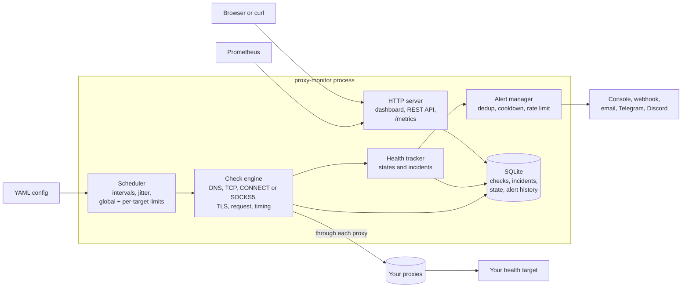

# Architecture

## Packages

| Package | Responsibility |
|---|---|
| `cmd/proxy-monitor` | CLI: `init`, `validate`, `check`, `start`, `status`, `report`, `target`, `demo`, `healthcheck` |
| `internal/config` | YAML loading, `${ENV}` expansion, defaults, validation, safety floors |
| `internal/checks` | One check: resolve, connect, HTTP forward / CONNECT / SOCKS5 (RFC 1928 and 1929), TLS, request; per-phase timing; failure classes |
| `internal/scheduler` | Per-proxy loops, jitter, global concurrency, per-target concurrency and spacing, manual checks, retention |
| `internal/health` | State machine per proxy: down, recovered, latency and availability incidents |
| `internal/alerts` | Flood control and the notifiers |
| `internal/storage` | SQLite schema and queries (pure Go driver, WAL mode) |
| `internal/stats` | Uptime, percentiles, time buckets |
| `internal/metrics` | Prometheus text exposition without the client library |
| `internal/server` | Dashboard, REST API, authentication and exposure safeguards |
| `internal/redact` | Credential masking used by every output path |
| `internal/testproxy` | Local HTTP and SOCKS5 proxies with fault injection, for tests and the demo |
| `web` | The embedded dashboard (HTML, CSS, JavaScript, no build step) |

## Design choices

- **Own protocol code instead of `net/http` proxy support.** The standard transport hides which phase failed and how. Doing the CONNECT and SOCKS5 handshakes directly gives exact timings per phase and precise failure classes (a 407 versus a SOCKS5 reply 0x04 versus silence on the wire).
- **One connection per check, `Connection: close`.** Each check measures a fresh connection, which is what a new client of the proxy experiences. Nothing is pooled between checks.
- **SQLite by default.** No server to run, one file to back up. Writes are serialized; reads run in parallel in WAL mode.
- **Configuration as code.** The dashboard is read-only. Changes go through the file and a restart, which keeps the monitored list reviewable and makes the web interface a smaller target.
- **Incidents are explicit rows.** Down, latency and availability periods have start and end times, so reports and the dashboard do not re-derive them from raw checks, and a restart continues the same incident.
- **No external requests from the dashboard.** No CDN, fonts or analytics, enforced by the Content-Security-Policy.
